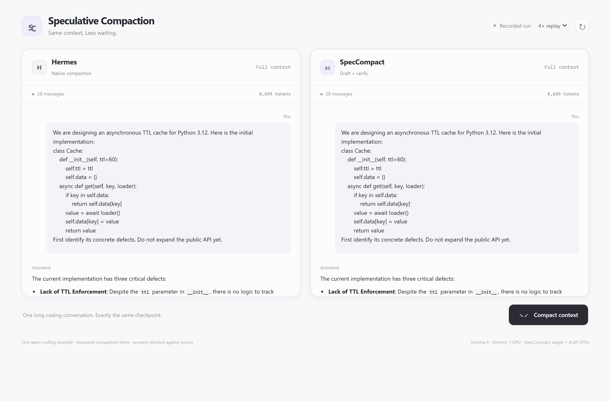

<h1 align="center">SpecCompact: Accelerating LLM Agent Context Compaction with Slot-Parallel Semantic Speculative Verification</h1>

<p align="center">
  
</p>

This repository provides the official implementation of **SpecCompact**, a
speculative context compaction method for **LLM agents**. SpecCompact uses a small
drafter to generate structured summary slots in parallel, verifies proposed lines
with a target model, and repairs rejected proposals with target-generated text.

## ⭐ Highlights

- **Slot-parallel drafting:** compact conversation history into six semantic
  slots: goals, constraints and preferences, progress, key decisions, next steps,
  and critical context.
- **Semantic speculative verification:** accept draft lines based on the target
  model's semantic judgment rather than exact token agreement.
- **Target repair:** replace rejected proposals with target-generated lines and
  continue drafting from the committed summary prefix.
- **Inference optimizations:** reuse a shared target prompt prefix and buffer
  draft lines while their accepted prefix remains valid.
- **Slot SFT pipeline:** prepare prompt-masked training data and fine-tune the
  drafter with the separately packaged LLaMA-Factory module.
- **Reusable interface:** run compaction through a CLI or Python API, with
  acceptance, token usage and timing metadata.

## 🔧 Requirements

Use **Python 3.12 or 3.13** and [uv](https://docs.astral.sh/uv/). Install the locked
inference environment from the repository root:

```shell
git clone git@github.com:shawnyin128/Speculative-Compaction.git
cd Speculative-Compaction
uv sync --locked --group inference
```

Compaction connects to separately running OpenAI-compatible model servers. The
draft server must expose `/v1/completions`; the target server must also expose
`/v1/chat/completions` with token log probabilities. Model serving requires
sufficient GPU memory for the selected models; the client does not allocate or
launch these servers.

The `inference` and `training` dependency groups use different library versions.
Select one group at a time; do not combine them with `--all-groups`.

## 👨‍💻 Pipeline

The method and its configuration are separate. Model-specific presets are in
[`configs/compact/`](configs/compact/):

| Target | SFT drafter | Config |
|---|---|---|
| `google/gemma-4-31B-it` | [sy128/SpecComp-slot-sft-gemma4-31B-it](https://huggingface.co/sy128/SpecComp-slot-sft-gemma4-31B-it) | [gemma4.yaml](configs/compact/gemma4.yaml) |
| `Qwen/Qwen3.5-122B-A10B` | [sy128/SpecComp-slot-sft-qwen3-5-122B-A10B](https://huggingface.co/sy128/SpecComp-slot-sft-qwen3-5-122B-A10B) | [qwen35.yaml](configs/compact/qwen35.yaml) |

Copy the preset for your target and edit the endpoint URLs and served model
names. Keep each endpoint's tokenizer matched to the corresponding model:

```shell
cp configs/compact/gemma4.yaml configs/compact/my_run.yaml
```

### 🎯 Run

**Run every command from the repository root.** The following steps use a
pretrained drafter; SFT is optional.

**Step 1: Configure the model endpoints.**

Set `draft.url`, `draft.model`, `target.url` and `target.model` in your YAML to
match the running servers. The presets use ports `8503` and `8502` and served
model aliases `draft` and `target`.

For authenticated servers, set the environment variable named by each endpoint's
`api_key_env` (default `VLLM_API_KEY`). Put only the environment variable name in
YAML. Inspect the effective settings without loading tokenizers or calling models:

```shell
uv run --locked --group inference speccompact compact \
  --config configs/compact/my_run.yaml --print-config
```

**Step 2: Compact the conversation context.**

Save the rendered conversation as UTF-8 text in `context.txt`:

```shell
uv run --locked --group inference speccompact compact \
  --config configs/compact/my_run.yaml \
  --input context.txt \
  --output outputs/compacted.json
```

Output: a JSON object containing the compacted `text`, `metadata` and effective
`configuration`. Metadata includes compaction wall time, accepted and repaired
line counts, and draft/judge/repair token usage and timing. Set
`record_llm_calls: true` to include individual call and slot decision records.
Per-role times may overlap; they are not additive wall time.

Use a new output path for each run. The method consumes the supplied context;
it does not select historical turns or silently truncate oversized prompts.

### 🔎 Config

Parameter definitions, defaults and validation live in
[`src/hparam/hparam.py`](src/hparam/hparam.py). The main compaction parameters are:

| Parameters | Default | Description |
|---|---|---|
| `draft`, `target` | Model-specific presets | Endpoint URL, served model name, tokenizer and API-key environment name. |
| `slot_concurrency` | `6` | Number of concurrent slot workers. Set `1` for serial slots. |
| `verify`, `verify_method` | `true`, `dreamr` | Enable semantic verification and select the probability (`dreamr`) or digit-score (`sr`) verifier. |
| `eta` | `0.7` for `dreamr`; `7` for `sr` | Acceptance threshold on the selected verifier's scale. Threshold equality accepts. |
| `max_lines`, `max_line_chars` | `12`, `400` | Per-slot line limit and per-line character limit. |
| `max_prompt_tokens`, `max_line_tokens` | `28000`, `64` | Prompt token guard and per-call generation limit. |
| `max_slot_tokens`, `summary_token_budget` | `320`, `2048` | Per-slot output budget and assembled-summary token guard. Set both to `null` to disable token budgets. |
| `line_split`, `buffer_extra_lines` | `client`, `true` | Split draft text into lines in the client and retain extra lines while the prefix remains valid. |
| `full_schema_prefix` | `false` | Preserve the drafter's single-slot SFT prompt format. |
| `fallback_full_schema_prefix`, `verify_shared_prefix` | `true`, `true` | Share the full-schema target prefix across verification and repair. |
| `structural_bypass` | `true` | Apply deterministic gates to structural lines without a model verification call. |
| `capture_timing`, `record_llm_calls` | `true`, `false` | Collect timing and optionally retain individual calls and decision records. |

### 🏋️ Drafter SFT

The training pipeline prepares slot-supervision data and invokes the actual
LLaMA-Factory LoRA SFT trainer. The framework is a separate module under
[`src/LlamaFactory/`](src/LlamaFactory/), with its original license.

**Step 1: Prepare the pretokenized dataset.**

Edit [`configs/data/slot-sft.yaml`](configs/data/slot-sft.yaml). Select either a
Hub dataset (`hf_dataset`) or a local Parquet directory (`local_data_dir`), and
set `splits` and `output_dir`. Local shards must match `<split>*.parquet`; source
rows require `trace_id`, `slot`, `context_text` and `slot_target`.

```shell
uv sync --locked --group training
uv run --locked --group training speccompact prepare-sft \
  --config configs/data/slot-sft.yaml
```

The builder preserves the shared training/inference prompt contract, masks prompt
labels, keeps complete targets with EOS, and writes an Arrow-backed `DatasetDict`
with a build manifest. The default hash split holds out whole trace IDs. Only
context may be shortened; overlong targets are dropped rather than truncated.

**Step 2: Fine-tune the drafter.**

Edit [`configs/train/gemma4.yaml`](configs/train/gemma4.yaml) or
[`configs/train/qwen35.yaml`](configs/train/qwen35.yaml). Set `tokenized_path` to
the dataset from step 1 and select a new `output_dir`:

```shell
uv run --locked --group training speccompact train-sft \
  --config configs/train/gemma4.yaml
```

The training model defaults to `Qwen/Qwen3-0.6B`; teacher-specific presets select
the data and output paths. The recipe uses LoRA rank `16`, alpha `32`, learning
rate `0.0001`, one epoch and BF16. Training requires the prebuilt `train` and
`validation` partitions and a compatible PyTorch/CUDA and attention setup.
The `flash_attn` setting is configurable. Teacher-target generation is outside
this repository's training entrypoint.

## ⚡ Python Interface

```python
from pathlib import Path

from compaction.compaction import Compactor
from hparam.hparam import load_config

parameters = load_config(Path("configs/compact/gemma4.yaml"), "compact")
compactor = Compactor(parameters)
result = compactor.compact(Path("context.txt").read_text(encoding="utf8"))

print(result.text)
print(result.metadata["elapsed_seconds"])
print(result.metadata["accept_rate"])
```

## 📚 Citation

Coming soon.

## 🤝 Contributing

Issues and pull requests are welcome. We thank the authors of
[LLaMA-Factory](https://github.com/hiyouga/LLaMA-Factory) for their training
framework.
